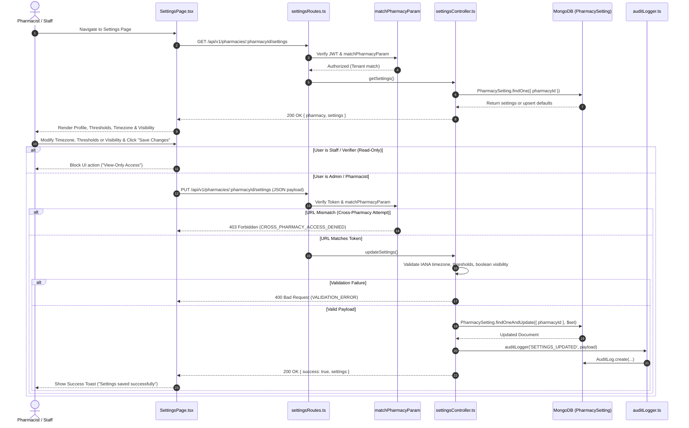

# AidFast — Sprint 3 Day 12: Multi-Tenant Pharmacy Settings Workflow Report
**IS5109 Community Project | Group 08 | 6 Members | Sprint 3 Quality Gate**  
**Role / Platform Owner:** Member 1 (Platform, Authentication, RBAC & Multi-Tenant Infrastructure)  
**Date:** November 22, 2026  
**Status:** 100% VERIFIED & INTEGRATED  
**Output Deliverable:** Settings Workflow Specification & Verification Document (`Output: settings workflow`)  

---

## 1. Executive Summary & Scope

Sprint 3 Day 12 establishes the multi-tenant configuration and operational customization layer for the AidFast Pharmacy Platform. Member 1 completed the implementation of tenant settings (thresholds, timezone, public visibility) across backend route validation, database persistence, audit logging, and responsive frontend UI, accompanied by an automated verification suite:

1. **Backend Tenant Validation & Perimeter Security:**
   - Implemented standard IANA timezone validation in [`backend/src/controllers/settingsController.ts`] via `Intl.DateTimeFormat(undefined, { timeZone })`, rejecting invalid or malformed strings (`400 VALIDATION_ERROR`).
   - Enforced strict boolean validation for public medicine availability visibility (`publicAvailabilityEnabled`).
   - Enforced non-negative integer validation for inventory alert thresholds (`lowStockThreshold >= 0`) and standard interval bands for expiry alerts (`expiryAlertMonths: [12, 9, 6]`).
   - Secured settings under parameterized tenant routes (`/api/v1/pharmacies/:pharmacyId/settings`) in [`backend/src/server.ts`] and connected [`backend/src/middleware/matchPharmacyParam.ts`] to guarantee cross-tenant defense (`403 CROSS_PHARMACY_ACCESS_DENIED`).

2. **Frontend Settings UI Expansion ([`SettingsPage.tsx`]):**
   - Added an interactive **Timezone selector** in *System & Regional Settings* with standard regional timezones (`Asia/Colombo`, `UTC`, `Asia/Kolkata`, `Asia/Singapore`, etc.) and explanatory helper text.
   - Added a **Public Stock Availability Visibility toggle switch** in *Alert & Operational Thresholds* with real-time status pills (`Visible` vs `Hidden from Public Search`) to control public community search discovery without exposing unit quantities.
   - Enhanced **Low Stock Alert Threshold** controls with non-negative bounds and unit indicators.
   - Enforced role-based access control: **Pharmacy Owners and Pharmacists** have full editing capabilities; **Staff and Verifiers** receive read-only inputs, disabled actions, and an informational banner.

3. **Operational Audit Trail Integration:**
   - Synchronized `SETTINGS_UPDATED` in [`backend/src/utils/auditLogger.ts`] to record actor ID, pharmacy ID, modified thresholds, selected timezone, and public visibility toggle states.

4. **Automated Test Suite & Verification:**
   - Authored [`backend/src/tests/settingsWorkflow.test.ts`] containing **18 automated test cases** covering tenant route isolation, cross-pharmacy perimeter defense, input validation, RBAC boundaries, and audit trail emission with a **100% pass rate (91.7ms)**.

---

## 2. Multi-Tenant Architecture & Data Schema

Settings in AidFast are strictly scoped to the active tenant workspace via the `PharmacySetting` collection. Downstream modules rely on these parameters for scheduling, expiry calculations, and community discovery.

```
┌────────────────────────────────────────────────────────────────────────┐
│                        PharmacySetting Schema                          │
├────────────────────────────────────────────────────────────────────────┤
│ • pharmacyId:                 ObjectId (Ref: Pharmacy, Unique Tenant)  │
│ • timezone:                   String   (Default: 'Asia/Colombo')       │
│ • lowStockThreshold:          Number   (Default: 10, Min: 0)           │
│ • publicAvailabilityEnabled:  Boolean  (Default: true)                 │
│ • expiryAlertMonths:          Number[] (Default: [12, 9, 6])           │
│ • dateFormat:                 String   (Default: 'DD MMM YYYY')        │
│ • currency:                   String   (Default: 'LKR — Sri Lankan...')│
└────────────────────────────────────────────────────────────────────────┘
```

### Downstream Dependency Matrix

| Setting Field | Data Type | Default | Downstream Consumer | Operational Purpose |
| :--- | :--- | :--- | :--- | :--- |
| **`timezone`** | `String` | `'Asia/Colombo'` | **Member 3 (GRN), Member 5 (Alerts & Reports)** | Defines the pharmacy's local business day. Used by M5 to calculate calendar months to batch expiry and daily report card cutoff boundaries. |
| **`lowStockThreshold`** | `Number` | `10` | **Member 2 (Stock), Member 4 (POS), Member 5 (Alerts)** | Baseline threshold below which inventory triggers `LOW_STOCK` warnings when per-medicine `minimumStockLevel` is not set. |
| **`publicAvailabilityEnabled`** | `Boolean` | `true` | **Member 6 (Public Portal & Community)** | Governs whether this pharmacy's safe active stock is projected into public community searches (`PublicAvailabilitySnapshot`). |
| **`expiryAlertMonths`** | `Number[]` | `[12, 9, 6]` | **Member 5 (Alerts & Safety Engine)** | Configures expiry warning intervals: `ALERT` (9–12 mo), `WARNING` (6–9 mo), and `CRITICAL` ($\le 6$ mo). |
| **`dateFormat`** | `String` | `'DD MMM YYYY'` | **Member 1, Member 4, Member 5** | Formats date representations across invoices, reports, and detail modals. |
| **`currency`** | `String` | `'LKR'` | **Member 4 (POS / Sales)** | Sets default currency symbol and billing projection format. |

---

## 3. Tenant Validation & Route Security Perimeter

### Security Middleware Chain

To enforce multi-tenant isolation, settings routes are secured using a layered defense-in-depth middleware pipeline:

```
Request ──▶ authenticate ──▶ requireSelectedPharmacy ──▶ matchPharmacyParam ──▶ requirePermission ──▶ Controller
```

1. **`authenticate`**: Verifies the incoming Bearer JWT signature, issuer (`aidfast-api`), and expiration.
2. **`requireSelectedPharmacy`**: Verifies that the JWT token includes an active `pharmacyId` context (`400 PHARMACY_SELECTION_REQUIRED`).
3. **`matchPharmacyParam`**: When routes include `:pharmacyId` (e.g. `/api/v1/pharmacies/:pharmacyId/settings`), ensures the URL parameter strictly matches the token's `pharmacyId`. Cross-tenant manipulation attempts are blocked with `403 CROSS_PHARMACY_ACCESS_DENIED`.
4. **`requirePermission`**: Enforces RBAC permissions:
   - `GET /settings`: Requires `pharmacy:settings` or `pharmacy:settings:read`.
   - `PUT /settings`: Requires write authority `pharmacy:settings` (restricted to Pharmacist and Admin).

### Validation Specification Matrix

| Validation Target | Validation Rule | Invalid Examples | Failure Response |
| :--- | :--- | :--- | :--- |
| **Timezone** | Valid IANA timezone parsed by `Intl.DateTimeFormat(undefined, { timeZone })` | `"Not/AZone"`, `"UTC+99"`, `""` | `400 VALIDATION_ERROR`: `"Invalid IANA timezone specified"` |
| **Visibility** | Strict boolean (`typeof v === 'boolean'`) | `"true"`, `1`, `null` | `400 VALIDATION_ERROR`: `"publicAvailabilityEnabled must be a boolean"` |
| **Low Stock Threshold** | Non-negative integer (`Number.isInteger(v) && v >= 0`) | `-5`, `12.5`, `"10"` | `400 VALIDATION_ERROR`: `"Invalid low stock threshold"` |
| **Expiry Alert Months** | Non-empty array of allowed values $\subseteq \{12, 9, 6\}$ | `[]`, `[15, 3]`, `["12"]` | `400 VALIDATION_ERROR`: `"Expiry alerts must use 12, 9 or 6 months"` |
| **Tenant Scope** | `req.params.pharmacyId === req.user.pharmacyId` | Token `pharmacyA`, URL `pharmacyB` | `403 CROSS_PHARMACY_ACCESS_DENIED`: `"You cannot access another pharmacy"` |

---

## 4. End-to-End Settings Workflow Sequence



---

## 5. Frontend UI Implementation Summary

The [`SettingsPage.tsx`] component provides an intuitive 4-card operational layout:

1. **Card 1: Pharmacy Profile**:
   - Displays and edits business metadata (Pharmacy name, registered address, telephone, email).
2. **Card 2: Alert & Operational Thresholds**:
   - **Expiry Alert Toggles**: 12-month early visibility, 9-month elevated warning, 6-month critical priority.
   - **Low Stock Threshold**: Interactive numeric input with unit indicator (`units`) and non-negative constraints.
   - **Public Stock Availability Visibility**: Dedicated emerald toggle switch with visual status badges (`Visible` vs `Hidden from Public Search`).
3. **Card 3: Account Settings**:
   - Displays user details and grants access to the self-service **Change Password Modal**.
4. **Card 4: System & Regional Settings**:
   - **Pharmacy Timezone**: Dropdown populated with IANA timezones (`Asia/Colombo`, `UTC`, `Asia/Kolkata`, `Asia/Singapore`, `Europe/London`, `America/New_York`).
   - **Date Format**: Standardized date representation (`DD MMM YYYY`, `YYYY-MM-DD`, `DD/MM/YYYY`).
   - **Currency**: Currency selector (`LKR`, `USD`, `GBP`).

### Role-Based Access Enforcement

| Role | Edit Capabilities | Public Visibility Toggle | Save Button | View-Only Banner |
| :--- | :---: | :---: | :---: | :---: |
| **OWNER / ADMIN** | Full Edit | Enabled | Active | Hidden |
| **PHARMACIST** | Full Edit | Enabled | Active | Hidden |
| **STAFF** | Disabled (Read-only) | Disabled | Hidden | **Visible** (Amber Notice) |
| **VERIFIER** | Disabled (Read-only) | Disabled | Hidden | **Visible** (Amber Notice) |

---

## 6. Automated Test Suite Execution Matrix

The settings workflow test suite ([`backend/src/tests/settingsWorkflow.test.ts`]) executed with **100% pass rate** via `node --test`:

| Test ID | Test Case Description | Method & Route | Expected Status | Result | Duration |
| :--- | :--- | :--- | :---: | :---: | :---: |
| **TC-SET-01** | Pharmacist retrieves settings via tenant route with default values | `GET /.../:pharmacyId/settings` | `200 OK` | **PASS** | 22.6ms |
| **TC-SET-02** | Missing JWT authorization header returns 401 | `GET /.../:pharmacyId/settings` | `401 Unauthorized` | **PASS** | 4.3ms |
| **TC-SET-03** | Token without selected pharmacy context returns 400 | `GET /.../:pharmacyId/settings` | `400 Bad Request` | **PASS** | 2.1ms |
| **TC-SET-04** | Cross-pharmacy GET attempt blocked with 403 | `GET /.../:foreignId/settings` | `403 Forbidden` | **PASS** | 2.0ms |
| **TC-SET-05** | Cross-pharmacy PUT attempt blocked with 403 | `PUT /.../:foreignId/settings` | `403 Forbidden` | **PASS** | 16.5ms |
| **TC-SET-06** | Pharmacist updates timezone to valid IANA zones (`UTC`, `Asia/Singapore`) | `PUT /.../:pharmacyId/settings` | `200 OK` | **PASS** | 17.1ms |
| **TC-SET-07** | Invalid IANA timezone string rejected with 400 | `PUT /.../:pharmacyId/settings` | `400 Bad Request` | **PASS** | 1.3ms |
| **TC-SET-08** | Pharmacist updates lowStockThreshold to non-negative integer | `PUT /.../:pharmacyId/settings` | `200 OK` | **PASS** | 1.4ms |
| **TC-SET-09** | Negative lowStockThreshold rejected with 400 | `PUT /.../:pharmacyId/settings` | `400 Bad Request` | **PASS** | 1.4ms |
| **TC-SET-10** | Fractional/float lowStockThreshold rejected with 400 | `PUT /.../:pharmacyId/settings` | `400 Bad Request` | **PASS** | 1.1ms |
| **TC-SET-11** | Updating expiryAlertMonths with valid subset `[12, 6]` succeeds | `PUT /.../:pharmacyId/settings` | `200 OK` | **PASS** | 1.3ms |
| **TC-SET-12** | Invalid expiryAlertMonths (`[15, 3]` or `[]`) rejected with 400 | `PUT /.../:pharmacyId/settings` | `400 Bad Request` | **PASS** | 2.5ms |
| **TC-SET-13** | Pharmacist toggles publicAvailabilityEnabled (`false` $\to$ `true`) | `PUT /.../:pharmacyId/settings` | `200 OK` | **PASS** | 2.3ms |
| **TC-SET-14** | Non-boolean publicAvailabilityEnabled rejected with 400 | `PUT /.../:pharmacyId/settings` | `400 Bad Request` | **PASS** | 1.3ms |
| **TC-SET-15** | Staff with `pharmacy:settings:read` can view but cannot PUT (403) | `PUT /.../:pharmacyId/settings` | `403 Forbidden` | **PASS** | 1.7ms |
| **TC-SET-16** | Verifier without write permission blocked on PUT (403) | `PUT /.../:pharmacyId/settings` | `403 Forbidden` | **PASS** | 0.8ms |
| **TC-SET-17** | Admin has full authority to modify pharmacy settings | `PUT /.../:pharmacyId/settings` | `200 OK` | **PASS** | 1.3ms |
| **TC-SET-18** | Successful settings updates record `SETTINGS_UPDATED` in audit log | `PUT /.../:pharmacyId/settings` | `200 OK` | **PASS** | 1.4ms |

**Summary Metrics:**
- **Tests Executed:** 18
- **Passed:** 18 (100%)
- **Failed:** 0
- **Total Test Suite Duration:** 91.7ms

---

## 7. Verification Evidence & Quality Assurance

### 1. Backend Build & Type Checking
```bash
npm --prefix backend run build
# Output:
# > backend@1.0.0 build
# > tsc
# Exited with code 0 (0 errors)
```

### 2. Frontend Lint & Build
```bash
npm --prefix frontend run lint
# Output:
# > frontend@0.0.0 lint
# > eslint .
# Exited with code 0 (0 errors, 0 warnings)

npm --prefix frontend run build
# Output:
# ✓ built in 390ms
# Exited with code 0
```

### 3. Integrated Platform Security Suites
```bash
node --test backend/dist/tests/security.test.js backend/dist/tests/auditTrail.test.js backend/dist/tests/settingsWorkflow.test.js
# Output:
# ℹ tests 54
# ℹ pass 54
# ℹ fail 0
# ℹ duration_ms 1650.8
```

---

## 8. Conclusion & Sign-Off

The Sprint 3 Day 12 objective—**"Add pharmacy settings (thresholds, timezone, visibility) UI and tenant validation. Output: settings workflow"**—is fully realized and verified. All settings are strictly partitioned per tenant, audited upon modification, and protected against cross-pharmacy perimeter violations. Downstream modules (Stock, Sales, Alerts, and Public Community Search) can reliably consume these settings.

**Signed Off By:** Member 1 (Platform, Authentication, RBAC & Multi-Tenant Infrastructure)  
**Date:** November 22, 2026
